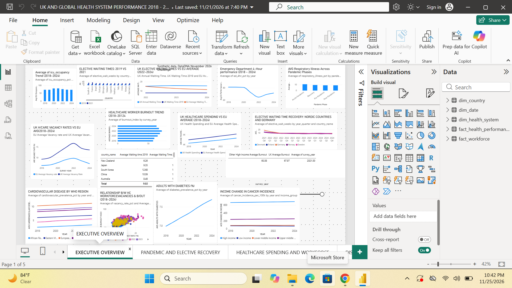
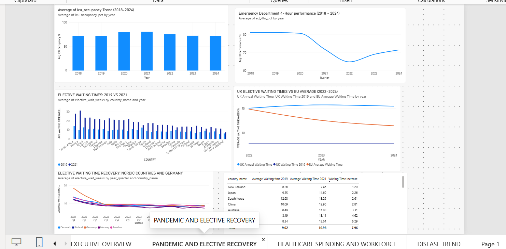
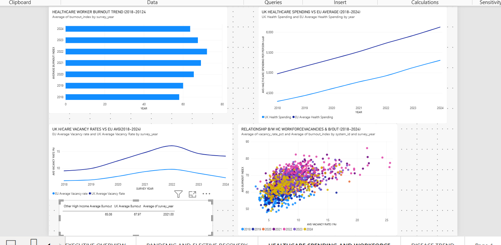
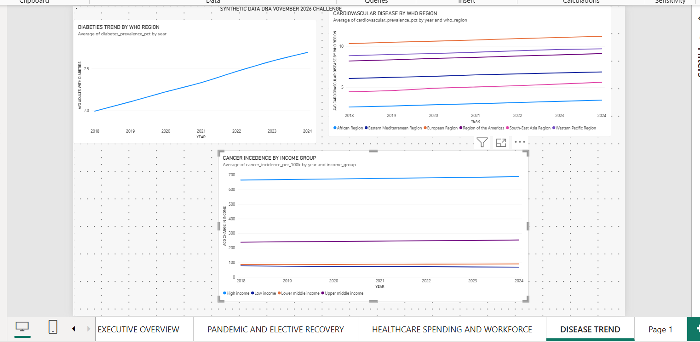

# Global Health System Performance Analysis (2018–2024)
- `Global_Health_System_Performance.pbix` – Interactive Power BI project file.
- `UK_AND_GLOBAL_HEALTH_PERFOMANCE_ANALYSIS.pdf` – Final project report.

## Project Overview
This project analyses global healthcare system performance from 2018 to 2024 using Power BI. It explores healthcare spending, waiting times, intensive care performance, workforce indicators and disease trends to identify patterns and compare healthcare performance across countries and regions.

## Tools & Technologies
- Microsoft Power BI
- Power Query
- DAX
- Data Modelling
- Data Visualisation

## Key Areas of Analysis

**1. Executive Overview**
- Overall healthcare system performance.
- Comparison of key healthcare indicators.

**2. Pandemic & Elective Recovery**
- Waiting-time trends.
- Healthcare service recovery.
- UK and EU comparisons.

**3. Healthcare Spending & Workforce**
- Healthcare expenditure analysis.
- Workforce burnout indicators.
- Staff vacancies and performance.

**4. Disease Trends**
- Cardiovascular disease trends across WHO regions.
- Disease prevalence analysis from 2018 to 2024.

## Technical Skills Demonstrated
- Data cleaning and transformation.
- Data modelling using fact and dimension tables.
- Creating table relationships.
- Developing DAX measures.
- Building interactive Power BI visualisations.
- Analysing trends and communicating findings.

## Project Files
- `Uk_And_Global_Health_System_Performance.pbix` – Power BI project file.
- `Project_Report.pdf` – Project analysis and findings (to be added).

## Key Learning Outcomes
This project strengthened my ability to work with structured datasets, develop data models, create analytical measures and communicate insights through interactive dashboards.

## Dashboard Previews

### 1. Executive Overview

### 2. Pandemic & Elective Recovery

### 3. Healthcare Spending & Workforce

### 4. Disease Trends

## Project Objectives

The objective of this project was to analyse global health system performance across 32 countries from 2018 to 2024 using Power BI.

The analysis focused on:

- Evaluating healthcare system performance across different countries.
- Comparing healthcare spending and workforce capacity.
- Examining waiting times and intensive care unit (ICU) occupancy.
- Analysing workforce shortages and burnout trends.
- Identifying cardiovascular disease trends across WHO regions.
- Comparing the UK's healthcare performance with EU averages.

The project aimed to transform healthcare data into meaningful insights that support evidence-based decision-making.

## Key Findings

The Power BI analysis produced the following findings across the 2018–2024 study period:

### 1. Elective Care Recovery
- Germany recorded the largest reduction in elective waiting times among the five countries analysed, falling by 9.45 weeks between 2021 Q4 and 2024 Q4.
- Norway recorded the lowest final waiting time at 7.51 weeks.
- UK waiting times remained above the 2019 baseline of 7.80 weeks through 2024.
- The UK–EU waiting-time gap widened to 4.00 weeks in 2024.

### 2. Healthcare Spending
- Healthcare spending increased in both the UK and EU over the period.
- UK average annual spending was approximately $4,780 per person, compared with $5,540 for the EU.
- UK spending remained lower than the EU average.

### 3. Healthcare Workforce
- Staff burnout peaked at 72.26 in 2022 before declining in 2023 and 2024.
- Higher vacancy rates generally appeared alongside higher burnout levels.
- UK vacancy rates remained above the EU average throughout the period, with the largest gap of 7 percentage points in 2022.

### 4. Disease Trends
- Cardiovascular disease prevalence increased across all six WHO regions between 2018 and 2024.
- South-East Asia recorded the largest increase of 1.15 percentage points.
- European Region cardiovascular disease prevalence increased from 10.32% to 11.21%.
- Recorded cancer incidence increased by 3.54% in high-income countries, while low-income countries recorded an 11.27% decline.

**Data note:** This project uses synthetic data created for the DataDNA November 2026 challenge. Findings represent the challenge scenario and should not be interpreted as actual national healthcare statistics.

## Recommendations

Based on the analysis, the following actions are recommended within the project scenario:

1. **Improve elective care recovery:** Prioritise waiting-list reduction strategies and monitor countries where waiting times remain above their baseline levels.

2. **Review healthcare resource allocation:** Examine differences in healthcare spending between the UK and EU to identify opportunities for more effective resource planning.

3. **Strengthen workforce planning:** Address staff shortages and monitor vacancy rates alongside burnout to support workforce wellbeing and retention.

4. **Prioritise disease prevention:** Strengthen long-term prevention and monitoring programmes in response to the rising cardiovascular disease and diabetes trends.

5. **Improve performance monitoring:** Use interactive dashboards and consistent performance indicators to track healthcare delivery, workforce capacity and emerging trends over time.

**Note:** These recommendations are based on patterns observed in the synthetic challenge dataset and are intended for analytical and learning purposes.

## Author
Abazie Olanma

Computer Science Graduate | Data Analyst | Business Intelligence

